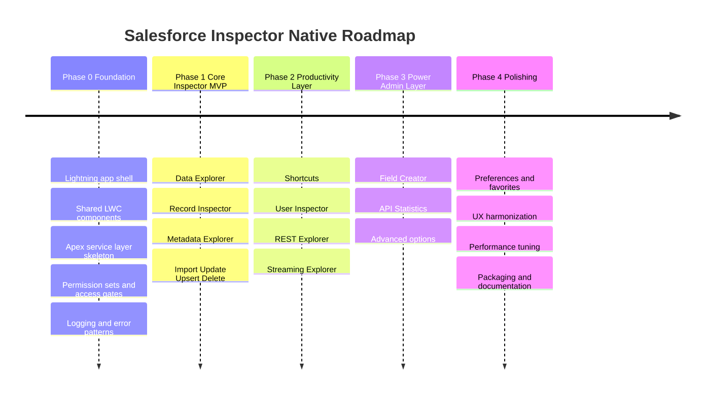

# Roadmap Salesforce Inspector Native

Date : 2026-04-08

## Vision

Salesforce Inspector Native doit permettre a un utilisateur deja habitue a Salesforce Inspector Reloaded de retrouver les memes reflexes de travail :

- inspecter rapidement les donnees
- lancer des requetes sans quitter Salesforce
- comprendre la structure metadata d'un objet ou d'un record
- faire des operations de masse sans outil externe
- disposer d'un hub admin/dev/productivity directement dans l'org

Le produit ne doit pas chercher une parite technique stricte avec l'extension navigateur.

Le but est plutot :

- une parite d'usage
- une sensation de familiarite
- une architecture native Salesforce evolutive

## Vue roadmap

## Principes produit

- Conserver des noms et patterns proches de SF Inspector Reloaded quand c'est pertinent.
- Afficher les API names, les identifiants et les infos techniques sans les cacher.
- Rendre les actions de copie, export, navigation et inspection tres rapides.
- Privilegier une Global Quick Action comme point de trigger principal.
- Conserver un shell Lightning comme workspace secondaire pour les ecrans lourds.
- Encadrer fortement les operations potentiellement sensibles.

## Experience cible

Le point de trigger principal de Salesforce Inspector Native est une Global Quick Action.

Cette action doit permettre d'ouvrir rapidement un launcher ou un module d'inspection sans obliger l'utilisateur a naviguer d'abord vers une app dediee.

Un utilisateur ouvre l'application Salesforce Inspector Native et retrouve des modules explicites :

- Data Explorer
- Import
- Record Inspector
- Metadata Explorer
- Shortcuts
- User Inspector
- REST Explorer
- Streaming Explorer
- Field Creator
- API Statistics

L'UX doit rester proche des usages d'un inspector :

- panneau de recherche ou de saisie
- execution immediate
- resultats tabulaires
- details techniques faciles a lire
- raccourcis de copie
- navigation rapide vers le record ou le setup associe

Mode d'acces recommande :

- `Primary trigger` : Global Quick Action
- `Secondary trigger` : autres points d'entree optionnels plus tard, par exemple utility bar
- `Deep workspace` : app Lightning complete pour les modules qui ont besoin de plus d'espace

## Roadmap par phases

### Phase 0 - Foundation

Objectif :

- poser l'ossature applicative et securitaire

Livrables :

- Global Quick Action principale
- launcher contextuel initial
- application Lightning de support
- navigation par modules ou workspace
- permission sets de base
- framework commun LWC pour tables, recherche, historique, notifications et copy-to-clipboard
- services Apex partages
- conventions de logging et de gestion d'erreurs

Resultat attendu :

- un trigger universel simple a deployer
- un shell solide pour brancher les modules sans refaire l'architecture a chaque feature

### Phase 1 - Core Inspector MVP

Objectif :

- livrer les capacites qui donnent tout de suite la sensation "SF Inspector"

Features :

- Data Explorer
- Record Inspector
- Metadata Explorer
- Data Import / Update / Upsert / Delete

Pourquoi d'abord :

- ce sont les usages les plus frequents
- ce sont les modules qui rendent l'application utile tres vite
- ce sont aussi les plus structurants pour les couches Apex et LWC

Definition of done :

- l'utilisateur peut lancer une requete SOQL
- l'utilisateur peut ouvrir un record et voir tous ses champs
- l'utilisateur peut parcourir la metadata d'un objet et de ses champs
- l'utilisateur peut charger un CSV, simuler puis executer une operation de masse

### Phase 2 - Productivity Layer

Objectif :

- accelerer la navigation et le debug admin/support/integration

Features :

- Shortcuts
- User Inspector
- REST API Explorer
- Streaming Explorer

Definition of done :

- l'utilisateur peut retrouver les destinations Setup utiles en quelques clics
- l'utilisateur peut comprendre le contexte d'un user
- l'utilisateur peut tester un endpoint REST Salesforce depuis l'application
- l'utilisateur peut observer des evenements et messages streaming autorises

### Phase 3 - Power Admin Layer

Objectif :

- ajouter les outils avances qui augmentent la productivite des admins experts

Features :

- Field Creator
- API Statistics
- options avancees de personnalisation et debug

Definition of done :

- l'application commence a remplacer une plus grande partie des usages experts de l'extension

### Phase 4 - Polishing and Compatibility

Objectif :

- faire converger l'experience vers une adoption large

Chantiers :

- harmonisation UX entre modules
- preferences utilisateur
- favoris et historique persistants
- optimisation des performances
- packaging et documentation admin
- matrice de compatibilite par profil de permission

## Priorisation synthese

### P0

- Global Quick Action
- launcher contextuel
- shell d'application de support
- Data Explorer
- Record Inspector
- Metadata Explorer
- Import/Update/Upsert/Delete
- securite et permission sets

### P1

- Shortcuts
- User Inspector
- REST Explorer
- Streaming Explorer

### P2

- Field Creator
- API Statistics
- options avancees

## Dependances transverses

Ces fondations devront etre pretes tot :

- moteur de permission checking
- framework de table dynamique
- couche Apex d'execution controlee
- historique utilisateur
- logging applicatif
- mecanismes de guardrails pour eviter les operations dangereuses

## Carte fondations et modules

## Risques connus

### 1. Limitations natives Salesforce

- pas d'injection dans toutes les pages standard comme une extension
- pas d'interception globale du reseau navigateur
- restrictions sur certaines APIs metadata ou setup

### 2. Performance

- les gros resultats SOQL
- les imports volumineux
- le chargement des metadata riches

### 3. Securite

- execution de requetes dynamiques
- operations de masse destructives
- exploration REST et metadata

### 4. Attentes des utilisateurs existants

- si l'UX est trop eloignee de SF Inspector Reloaded, la sensation de familiarite diminuera

## Criteres de succes

- un utilisateur de SF Inspector Reloaded comprend l'app sans onboarding lourd
- les modules les plus frequents sont plus rapides qu'un enchainement Setup + Developer Console + Workbench
- les admins ont confiance dans les operations grace aux ecrans de preview, validation et journalisation
- l'architecture supporte l'ajout de nouveaux modules sans rework majeur

## Sequence de livraison recommandee

1. Foundation shell + permission sets + composants communs
2. Global Quick Action + quick launcher contextuel
3. Data Explorer
4. Record Inspector
5. Metadata Explorer
6. Import / mass actions
7. Shortcuts
8. User Inspector
9. REST Explorer
10. Streaming Explorer
11. Field Creator
12. API Statistics

## Recommandation de nommage produit

Pour rassurer les utilisateurs venant de Reloaded, il est utile de garder des labels familiers :

- `Data Explorer`
- `Import`
- `Show All Data` ou `Record Inspector`
- `Metadata Explorer`
- `Shortcuts`
- `REST Explorer`

L'application peut avoir une terminologie interne plus technique, mais les labels visibles doivent rester familiers.
