# Salesforce Inspector Native - technical spec high level

Date : 2026-04-08

## Objectif

Definir une direction technique high level pour recréer dans Salesforce les principales fonctionnalites de Salesforce Inspector Reloaded.

Le document doit aider a repondre a trois questions :

1. quelles features implementer
2. comment les recreer de maniere credible en LWC/Apex
3. quelles fondations communes sont necessaires pour offrir une experience familiere aux utilisateurs de SF Inspector Reloaded

## Guiding principles

- Reproduire la logique d'usage avant de rechercher une copie exacte de l'extension.
- Utiliser une Global Quick Action comme trigger principal.
- Conserver une application Lightning dediee comme workspace secondaire.
- Isoler les operations sensibles dans des services Apex bien gardes.
- Mutualiser un maximum de composants d'interface et de services techniques.
- Garder les labels, patterns d'affichage et raccourcis cognitifs proches de Reloaded.

## Architecture cible high level

### Couches principales

#### 1. Entry Layer

Responsabilite :

- offrir un point d'ouverture simple et packagable
- lancer l'experience avec ou sans contexte
- router l'utilisateur vers le bon module

Implementation envisagee :

- Global Quick Action `Open SF Inspector Native`
- composant launcher `sinQuickLauncher`
- detection du contexte quand il est disponible

#### 2. Lightning App Shell

Responsabilite :

- fournir le workspace complet
- heberger les modules lourds
- centraliser les preferences utilisateur et le contexte courant

Implementation envisagee :

- app Lightning dediee
- page d'accueil "hub"
- possibilite de workspace a onglets internes via LWC parent

#### 3. LWC Module Layer

Responsabilite :

- fournir un module fonctionnel par grande feature

Modules envisages :

- `sinQuickLauncher`
- `sinDataExplorer`
- `sinImportWizard`
- `sinRecordInspector`
- `sinMetadataExplorer`
- `sinShortcuts`
- `sinUserInspector`
- `sinRestExplorer`
- `sinStreamingExplorer`
- `sinFieldCreator`
- `sinApiStatistics`

#### 4. Shared LWC Components

Responsabilite :

- eviter de reconstruire les memes patterns partout

Composants partages envisages :

- `sinAppShell`
- `sinContextBanner`
- `sinModuleHeader`
- `sinSearchBar`
- `sinDynamicDatatable`
- `sinKeyValueGrid`
- `sinJsonViewer`
- `sinCsvPreviewTable`
- `sinHistoryPanel`
- `sinFavoriteButton`
- `sinActionToolbar`
- `sinPermissionGate`
- `sinEmptyState`
- `sinErrorPanel`

#### 5. Apex Service Layer

Responsabilite :

- encapsuler la logique serveur
- controler les droits
- appeler les APIs Salesforce utiles

Services envisages :

- `SIN_ContextService`
- `SIN_QueryService`
- `SIN_RecordService`
- `SIN_MetadataService`
- `SIN_ImportService`
- `SIN_UserInspectorService`
- `SIN_ShortcutService`
- `SIN_RestExplorerService`
- `SIN_StreamingService`
- `SIN_FieldCreatorService`
- `SIN_StatsService`
- `SIN_PreferenceService`
- `SIN_AccessService`

#### 6. Persistence / Settings Layer

Responsabilite :

- memoriser les preferences, historiques, favoris et journaux

Options envisagees :

- Custom Metadata Types pour la configuration globale
- Custom Objects pour l'historique ou les journaux applicatifs
- Platform Cache pour certains caches temporaires
- browser storage local seulement pour de la commodite UI non critique

## Foundation technique commune

### Entry and navigation

Le point de trigger principal doit etre une Global Quick Action.

Recreation cible de l'experience Reloaded :

- un utilisateur doit pouvoir ouvrir l'inspector depuis presque n'importe ou
- si le contexte courant est detectable, l'outil doit le reutiliser immediatement
- si le contexte n'est pas detectable, l'utilisateur doit pouvoir continuer en mode manuel
- une fois dans l'outil, les modules doivent rester faciles a atteindre

Implementation possible :

- Global Quick Action ouvrant `sinQuickLauncher`
- `sinQuickLauncher` propose des actions contextuelles ou une redirection vers le workspace complet
- app Lightning servant de destination pour les modules qui ont besoin de plus d'espace

### Historique et favoris

Pour donner une sensation d'outil mature, plusieurs modules doivent partager :

- historique de requetes
- requetes favorites
- derniers records consultes
- derniers objets consultes
- raccourcis favoris

Implementation possible :

- objet custom `SIN_User_Artifact__c` ou plusieurs objets dedies
- ou stockage hybride avec persistance minimale serveur et cache local client

### Permission model

Chaque module doit pouvoir etre active desactive par permission set.

Implementation possible :

- permission sets par module
- classe Apex `SIN_AccessService` qui expose les droits au front
- composant `sinPermissionGate` cote LWC

### Audit and safety

Toute fonction sensible doit avoir :

- prevalidation
- confirmation utilisateur
- journal d'execution
- rendu lisible des erreurs

Cela concerne surtout :

- import et delete
- creation de champs
- execution REST
- streaming avancé si administration de channels

### Context detection

La detection de contexte doit etre vue comme un bonus intelligent, pas comme une dependance absolue.

Contexte utile a exploiter quand disponible :

- `recordId`
- `objectApiName`
- type de page Lightning
- parametres de navigation passes explicitement au launcher

Implementation possible :

- lecture du contexte via navigation state et parametres
- passage explicite du contexte entre launcher et modules
- service `SIN_ContextService` pour normaliser le contexte cote serveur si necessaire

Si le contexte n'est pas disponible :

- saisie manuelle d'un record Id
- recherche objet
- acces direct aux modules principaux

## Trigger principal

### Global Quick Action

Le trigger principal retenu pour la V1 est :

- `Global Quick Action` ouvrant `sinQuickLauncher`

Pourquoi :

- packagable
- facile a deployer
- pas besoin d'ajouter un composant sur toutes les record pages
- bonne compatibilite avec une distribution multi-org
- point d'entree simple pour les utilisateurs

### Quick launcher

Le launcher doit servir de porte d'entree legere et contextuelle.

Comportement cible :

- afficher le contexte courant si detecte
- proposer des actions rapides
- ouvrir directement un module cible
- rediriger vers le workspace complet si l'action demande plus de place

Actions initiales recommandees :

- `Inspect Current Record`
- `Open Record Inspector`
- `Open Metadata Explorer`
- `Open Data Explorer`
- `Open Shortcuts`
- `Paste Record Id`

## Feature-by-feature technical direction

### 1. Data Explorer

#### Experience cible

Equivalent natif du coeur de SF Inspector :

- saisir ou coller une requete SOQL
- executer rapidement
- voir le resultat sous forme tabulaire
- ouvrir un record ou copier une valeur
- exporter le resultat

#### LWC envisage

- `sinDataExplorer`
- sous-composants :
- `sinQueryEditor`
- `sinQueryResultTable`
- `sinHistoryPanel`
- `sinFavoriteButton`

#### Apex envisage

- `SIN_QueryService`

Responsabilites :

- valider le type de requete autorise
- executer SOQL et SOSL dans un cadre controle
- serialiser les resultats pour un datatable dynamique
- fournir des infos de pagination ou de continuation
- generer l'export CSV

#### Capacites techniques necessaires

- parse minimum des requetes pour distinguer lecture et operations non autorisees
- transformation des `SObject` en structure colonnes + lignes
- support des champs relationnels
- gestion des gros volumes avec limites explicites

#### Ce qu'il faut pour recréer la meme sensation

- execution tres rapide
- table dense et technique
- actions de copie sur cellule
- liens directs vers records
- historique et favoris visibles
- ouverture facile depuis le quick launcher

#### Contraintes

- eviter tout chemin qui permettrait d'executer du SOQL dangereux sans garde-fous
- bien definir la limite de lignes par execution et le mode d'export

### 2. Data Import / Update / Upsert / Delete

#### Experience cible

Equivalent de l'import/mass update de Reloaded :

- charger un CSV
- mapper les colonnes
- choisir une operation
- previsualiser
- executer et obtenir un rapport ligne par ligne

#### LWC envisage

- `sinImportWizard`
- etapes :
- upload
- choix objet
- mapping
- validation
- simulation
- execution
- rapport

#### Apex envisage

- `SIN_ImportService`

Responsabilites :

- parser le payload CSV
- faire le mapping vers un schema objet
- verifier accessibilite des champs
- executer `Database.insert/update/upsert/delete` avec `allOrNone=false`
- produire un rapport detaille

#### Capacites techniques necessaires

- parse CSV robuste
- resolution des external IDs pour upsert
- validation de types simple avant execution
- segmentation en batchs internes si besoin

#### Ce qu'il faut pour recréer la meme sensation

- wizard simple
- previsualisation lisible
- erreurs par ligne tres visibles
- sentiment de controle avant l'execution

#### Contraintes

- besoin fort de permissions et de confirmation
- les operations destructives doivent avoir une UX de confirmation plus forte

### 3. Record Inspector

#### Experience cible

Equivalent de "Show All Data" :

- entrer un record Id
- voir tous les champs techniques et metier
- chercher un champ
- copier facilement les valeurs
- pouvoir etre ouvert directement depuis la Global Quick Action quand un contexte record est disponible

#### LWC envisage

- `sinRecordInspector`
- sous-composants :
- `sinRecordLookup`
- `sinKeyValueGrid`
- `sinFieldSearchBar`

#### Apex envisage

- `SIN_RecordService`

Responsabilites :

- determiner le type sObject a partir de l'Id
- decrire l'objet
- construire une requete de lecture des champs autorises
- retourner metadonnees et valeurs dans un format stable pour le front

#### Capacites techniques necessaires

- describe sur sObject
- flattening des valeurs pour affichage
- support des champs de systeme, references et formules

#### Ce qu'il faut pour recréer la meme sensation

- liste exhaustive des champs
- affichage label + API name
- copie rapide
- liens vers objets lies ou metadata du champ
- lancement contextuel en un clic depuis le trigger principal

### 4. Metadata Explorer

#### Experience cible

Equivalent de l'inspection objet/champ :

- chercher un objet
- voir ses metadonnees importantes
- parcourir les champs
- ouvrir un detail de champ

#### LWC envisage

- `sinMetadataExplorer`
- sous-composants :
- `sinObjectPicker`
- `sinFieldList`
- `sinFieldDetailPanel`

#### Apex envisage

- `SIN_MetadataService`

Responsabilites :

- lister les objets accessibles
- fournir les describes d'objet et de champ
- enrichir avec informations utiles si disponibles

#### Capacites techniques necessaires

- `Schema.getGlobalDescribe()`
- describe objet et champ
- normalisation dans un DTO stable

#### Ce qu'il faut pour recréer la meme sensation

- recherche rapide d'objet
- table de champs dense
- detail de champ lisible
- navigation rapide vers relation parent/enfant si possible

### 5. Shortcuts

#### Experience cible

Equivalent du module de raccourcis :

- ouvrir vite les pages Setup importantes
- retrouver des liens contextuels

#### LWC envisage

- `sinShortcuts`
- variantes :
- catalogue global
- shortcuts contextuels par objet ou record

#### Apex envisage

- `SIN_ShortcutService`

Responsabilites :

- fournir un catalogue standard
- fusionner raccourcis standards et personnalisations locales

#### Capacites techniques necessaires

- generation d'URL Lightning ou Setup
- modele de configuration extensible

#### Ce qu'il faut pour recréer la meme sensation

- tres peu de clics
- categories claires
- contexte record et objet quand pertinent

### 6. User Inspector

#### Experience cible

- rechercher un utilisateur
- visualiser son contexte admin/support
- ouvrir rapidement ses artefacts lies

#### LWC envisage

- `sinUserInspector`

#### Apex envisage

- `SIN_UserInspectorService`

Responsabilites :

- recherche users
- agregation profil, role, permission sets, infos de base
- ajout d'actions rapides

#### Capacites techniques necessaires

- SOQL sur `User`
- jointures ou requetes complementaires sur permissions
- integration eventuelle de login history selon droits et faisabilite

#### Ce qu'il faut pour recréer la meme sensation

- vue compacte mais tres informative
- accent sur les infos utiles au debug

### 7. REST API Explorer

#### Experience cible

- tester une requete REST Salesforce depuis l'application
- voir statut, headers et body

#### LWC envisage

- `sinRestExplorer`
- sous-composants :
- `sinRequestBuilder`
- `sinJsonViewer`
- `sinResponseMeta`

#### Apex envisage

- `SIN_RestExplorerService`

Responsabilites :

- encapsuler les appels HTTP vers Salesforce APIs cibles
- appliquer une politique de securite et de whitelisting
- journaliser les executions

#### Capacites techniques necessaires

- Named Credential ou mecanisme d'appel controle
- support GET, POST, PATCH, DELETE si retenu
- rendu JSON lisible

#### Ce qu'il faut pour recréer la meme sensation

- grande souplesse dans la saisie
- execution immediate
- reponses brutes consultables

#### Contraintes

- a cadrer precisement pour eviter un proxy trop permissif

### 8. Streaming Explorer

#### Experience cible

- se connecter a des channels autorises
- observer les messages entrants

#### LWC envisage

- `sinStreamingExplorer`

#### Apex / integration envisagee

Deux pistes high level :

- front LWC avec librairie adapteee pour CometD / streaming si techniquement acceptable
- couche serveur ou service intermediaire si la connexion directe ne convient pas

Services cibles :

- `SIN_StreamingService`

Responsabilites :

- fournir la configuration de channels disponibles
- enregistrer les abonnements favoris
- stocker eventuellement un historique leger

#### Ce qu'il faut pour recréer la meme sensation

- liste de channels simple
- visualisation live
- log des derniers messages

#### Contraintes

- cette feature dependra fortement des possibilites techniques reelles cote Salesforce UI
- il faudra probablement commencer par une version reduite

### 9. Field Creator

#### Experience cible

- creer un champ rapidement avec un assistant plus efficace que le Setup standard

#### LWC envisage

- `sinFieldCreator`
- parcours :
- choix objet
- choix type
- definition label/API name/options
- recap
- execution

#### Apex envisage

- `SIN_FieldCreatorService`

Responsabilites :

- valider la demande
- appeler les APIs metadata retenues
- gerer le suivi d'execution et les erreurs

#### Capacites techniques necessaires

- etude precise des APIs metadata accessibles depuis ce contexte
- garde-fous stricts

#### Ce qu'il faut pour recréer la meme sensation

- creation rapide
- moins de friction que le Setup
- templates de champs frequents

#### Contraintes

- feature a ne lancer qu'apres verification technique detaillee

### 10. API Statistics

#### Experience cible

- voir les appels lances par Salesforce Inspector Native
- identifier temps de reponse et erreurs

#### LWC envisage

- `sinApiStatistics`

#### Apex envisage

- `SIN_StatsService`

Responsabilites :

- enregistrer les executions des modules qui font des appels
- exposer des agrégats et historiques de session

#### Capacites techniques necessaires

- journalisation standardisee
- stockage simple des metriques

#### Ce qu'il faut pour recréer la meme sensation

- dashboard compact
- stats par endpoint et statut

#### Contraintes

- contrairement a l'extension, on ne verra pas tout le trafic navigateur
- le scope initial doit etre clairement explicite aux users

## Shared data and config model

## Configuration globale

Elements a prevoir :

- modules actives
- limites par module
- policies de securite
- catalogue de shortcuts
- endpoints ou versions d'API autorisees

Support envisage :

- Custom Metadata Types

## Preferences utilisateur

Elements a prevoir :

- favoris
- historiques
- dernier objet consulte
- dernier mode d'import
- preferences d'affichage

Support envisage :

- custom object dedie ou stockage hybride

## Logging applicatif

Elements a prevoir :

- executions de requetes
- imports
- appels REST
- erreurs UI et serveur

Support envisage :

- custom object leger ou event/logging strategy dediee

## Patterns LWC a reutiliser

### Dynamic datatable

Il faut un composant commun capable de :

- recevoir des colonnes dynamiques
- gerer tri, recherche locale, copy, navigation
- afficher des types mixtes

### Inspector panel

Il faut un pattern de panneau detail capable de :

- afficher label + API name
- grouper les informations techniques
- proposer les actions de copie

### Wizard pattern

Pour l'import et le field creator :

- progression par etapes
- recap avant execution
- affichage clair des erreurs

### JSON and raw response viewer

Pour les features API et debug :

- affichage JSON formate
- copie facile
- mode brut et mode lisible

## Securite et guardrails

### Regles minimales

- toutes les actions serveur passent par Apex controle
- verification explicite des permissions module + objet + champ
- whitelisting des operations autorisees
- journalisation des actions sensibles
- confirmation avant actions destructives

### Features a encadrer le plus

- import delete
- upsert massif
- REST explorer
- field creator

## Ce qu'il faudra trancher pendant la vraie implementation

- strategie exacte de persistance des historiques et favoris
- niveau de flexibilite du moteur SOQL
- mecanisme technique retenu pour REST explorer
- faisabilite exacte du streaming explorer en pur Salesforce
- faisabilite exacte du field creator selon APIs metadata disponibles
- choix UX entre app page unique et modules separes

## Definition de "familiarite Reloaded"

Un user de Salesforce Inspector Reloaded doit reconnaitre :

- les noms des modules
- les principaux workflows
- la densite informative des ecrans
- la rapidite pour passer de question a reponse
- la possibilite d'obtenir tout de suite les infos techniques utiles

Si l'app fait cela, meme avec une implementation tres differente sous le capot, alors l'objectif produit est atteint.
